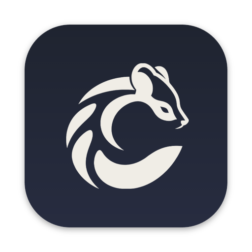

<h1 align="center">
   Civet
</h1>

<p align="center">
  <a href="https://github.com/sharithg1/civet/releases/latest"></a>
  
  
</p>

<p align="center">
  <strong>Your coding agents, on your dev box, that never disconnect.</strong><br/>
  Run Claude Code, Codex or any CLI agent on a remote machine, each in its own git worktree,<br/>
  from a native Mac app that survives sleep, Wi-Fi changes and restarts.
</p>

<h3 align="center"><a href="https://github.com/sharithg1/civet/releases/latest"><ins>Download Civet</ins></a></h3>

<p align="center">
  
</p>

## Why Civet

Agents are best on a big Linux box, next to your code, your toolchains and
your GPUs. But SSH sessions die when your laptop sleeps, and tmux makes
juggling a dozen agents painful. Civet keeps every agent running on the host
and gives you a real app to watch and steer them, with a connection built
like [mosh](https://mosh.org): close the lid, switch networks, reopen it, and
you are back on the next packet. No reconnect spinner.

## Features

### Never disconnects
Sessions run on the host and stream to your Mac over QUIC. Sleep, roaming
between networks and app restarts resume in milliseconds, with nothing lost.
If UDP is blocked, Civet falls back to an SSH tunnel on its own.

### Parallel worktrees
Every task gets its own git worktree and branch, so agents never step on each
other. Create, switch (<kbd>⌘K</kbd>) and remove worktrees from the sidebar.

### Knows what your agents are doing
Claude Code and Codex report **running**, **needs input** and **done** right
in the sidebar, with notifications when an agent finishes or waits on you.
No setup and no changes to your `~/.claude` or `~/.codex`.

### Hand off side tasks
Ask an agent to "hand off" a side task and it writes a brief, spins up a new
worktree and starts a fresh agent on it, without leaving your current branch.
[How it works →](docs/HANDOFF.md)

### Fast terminals, even on slow links
Splits, tabs and full scrollback kept on the host. Typing feels local:
mosh-style echo prediction kicks in on high-latency connections.

### Port forwarding
See what is listening on the host and forward it to your Mac in one click.
Forwards survive sleep and network changes like everything else.

### One-command setup
Point Civet at any `ssh` destination (your `~/.ssh/config` aliases work).
It uploads its daemon, starts it and keeps it updated. Or run everything on
**This Mac**.

## Supported agents

Works with **any CLI agent**: if it runs in a terminal, it runs in Civet.
**Claude Code** and **Codex** get live status and notifications out of the box.

## Install

1. Download the `.dmg` for your Mac (Apple silicon or Intel) from the
   [latest release](https://github.com/sharithg1/civet/releases/latest) and
   drag Civet to Applications.
2. If macOS says the app cannot be opened (unsigned builds), run once:

   ```sh
   xattr -dr com.apple.quarantine /Applications/Civet.app
   ```

3. Open Civet and connect to an ssh host, or pick **This Mac**.

Optional: to let agents hand off tasks, run `civet install-skills` once
from any Civet pane on that host.

## How it works

A small Rust daemon, `civetd`, runs on your dev box and owns the repos,
worktrees and every terminal. The Mac app only draws them. SSH is used once
to start the daemon; after that the app talks to it over an encrypted QUIC
connection that sends screen diffs, not raw bytes, so a resumed session is
always correct and catching up is instant.

Read more in [docs/ARCHITECTURE.md](docs/ARCHITECTURE.md).

## Development

Building from source, the crates, the test suite and measured performance:
see [docs/DEVELOPMENT.md](docs/DEVELOPMENT.md). Releases:
[docs/RELEASING.md](docs/RELEASING.md).
